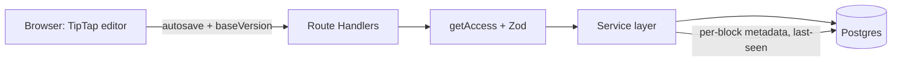

# Architecture note

Short version. Depth: [ARCHITECTURE.md](ARCHITECTURE.md) and [DECISIONS.md](DECISIONS.md) (ADRs).

## What we prioritized, and why

1. **The core brief first:** create/edit rich text, reliable save and reopen, file import, sharing with roles, server-enforced access. All of it works end to end before anything else.
2. **One differentiator, built on that core:** *catch-up by default*. Opening a doc someone else changed marks the changed blocks inline, with who and when. Around it: a **handoff note** attached to a share, a **conflict-safe save** (stale writes get a 409 and a recovery banner, never a silent overwrite), and an **import report** with Undo. Together they answer "what happened while I was away?" without extra setup.

Real-time co-editing was a deliberate non-goal (see trade-offs).

## Stack

| Layer | Choice |
|---|---|
| App | Next.js App Router, TypeScript, mutations via Route Handlers |
| Editor | TipTap v3 (ProseMirror), content stored as JSON |
| Data | Postgres via Drizzle: Neon in prod, PGlite locally and in tests |
| UI | Tailwind, shadcn/ui, Framer Motion, one Rive hero animation |
| Tests | Vitest at the route-handler level (no E2E) |
| Deploy | Vercel Hobby + Neon free; migrate and seed on each deploy |

## Data model

- `users(id, email, name)` seeded; `documents(id, owner_id, title, content jsonb, block_meta jsonb, version, last_edited_by)`
- `shares(document_id, user_id, role viewer|editor, note, note_seen_at)`
- `document_views(user_id, document_id, last_seen_at)` drives catch-up
- `block_meta` records who last changed each top-level block and when.

## Access model

Owner / editor / viewer. One `getAccess()` is used by every document route. Viewers get 403 on writes; users with no access get 404, so existence is not leaked. A matrix test covers it.

## Key trade-offs

- **Last-write-wins plus a version check, not a CRDT.** Each save carries `baseVersion`; a stale one returns 409. Simple and honest for a take-home; two people typing at once will see a conflict, not a merge.
- **Simulated auth.** Pick a seeded user, signed cookie. No passwords or OAuth. Not for real data.
- **Catch-up at top-level block granularity.** Tells you which paragraph/list changed and who changed it, not a word-level diff.
- **Rate limits are per instance.** An in-memory limiter returns 429 `RATE_LIMITED`; on serverless it is not shared across instances. A shared store (Upstash) is the real fix.
