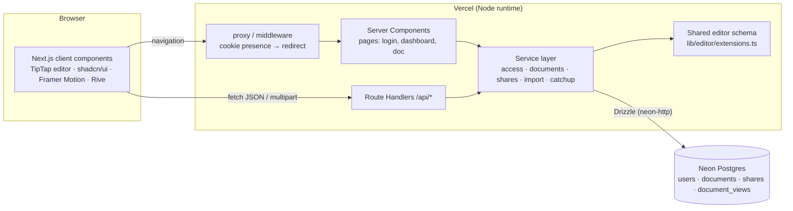
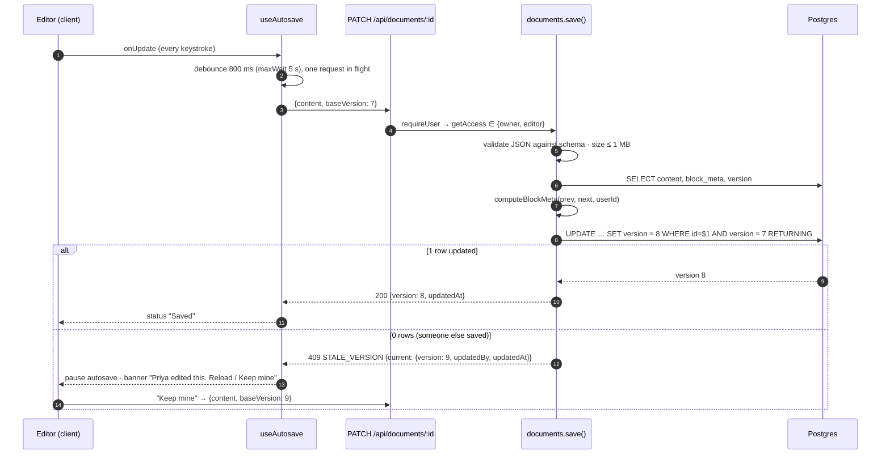
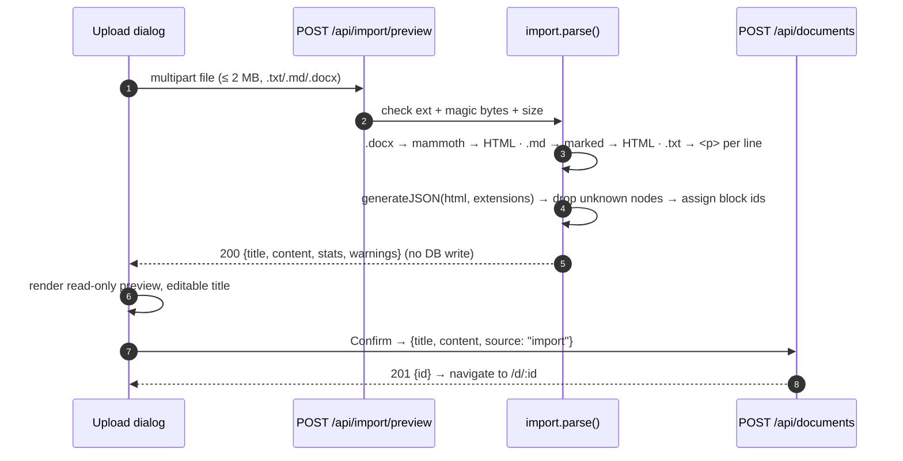
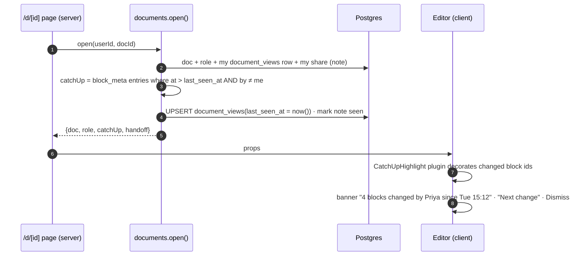

# Ajaia Docs — Technical Architecture

> Companion to [`../PLAN.md`](../PLAN.md) (requirements, FR/NFR checklists) and [`DECISIONS.md`](DECISIONS.md) (ADRs).
> Status: design, pre-build. Timebox 4–6 h, so every section is scoped to what fits in it.

---

## 1. Context

A small Google-Docs-style editor: seeded users create rich-text documents, import files, and share them with viewer or editor roles. It runs as one Next.js app on Vercel with Postgres on Neon, all on free tiers.

### Goals
| # | Goal | Measured by |
|---|---|---|
| G1 | No lost work | Debounced autosave, flush on blur/hide, **409 on stale write** instead of silent overwrite |
| G2 | Lossless formatting | Content stored as TipTap/ProseMirror JSON; reopen renders identically |
| G3 | Access enforced on the server | One `getAccess()` used by every document route; covered by a matrix test |
| G4 | Collaboration that feels real without real-time sync | Catch-up highlights, handoff notes, conflict banner |
| G5 | Zero-cost, zero-setup review | Live URL with seeded users; `npm test` needs no database (PGlite) |

### Non-goals
Real-time co-editing (CRDT), real authentication, comments and suggestions, version history, images and tables, PDF import, link sharing, mobile-first layout.

---

## 2. System overview



- **One deployable.** Pages render on the server by calling the service layer directly. Mutations go through Route Handlers so the HTTP contract (status codes, 409) is explicit and testable.
- **One editor schema.** The same TipTap extension list runs in the browser editor, in server-side content validation, and in the import parser. Anything the editor can't represent gets dropped at the boundary.

### 2.1 Autosave with optimistic concurrency



### 2.2 Share with handoff note

```mermaid
sequenceDiagram
  autonumber
  participant O as Owner UI (Share dialog)
  participant R as PUT /api/documents/:id/shares
  participant S as shares.upsert()
  participant D as Postgres
  participant V as Recipient dashboard
  O->>R: {email, role: "editor", note: "Can you tighten §2?"}
  R->>S: requireUser → getAccess == owner
  S->>S: Zod · lower(email) · not self · user exists
  S->>D: INSERT … ON CONFLICT (document_id,user_id) DO UPDATE role, note, note_seen_at = NULL if note changed
  S-->>O: 201 created | 200 updated {share}
  V->>D: (next load) GET dashboard → shared[] incl. note if note_seen_at IS NULL
  Note over V: Card shows note; first open shows it in a banner and marks it seen
```

### 2.3 Import with preview



### 2.4 Catch-up on open



---

## 3. Frontend

### 3.1 Route map
| Route | Render | Purpose | Guards |
|---|---|---|---|
| `/login` | Server | Pick one of the seeded users | Redirect to `/` if already signed in |
| `/` | Server + client islands | Dashboard: **My documents** / **Shared with me**, New, Import | Session |
| `/d/[id]` | Server shell + client editor | Editor, title, toolbar, share, catch-up, handoff banner | Session; `getAccess` (no access → `notFound()`) |
| `not-found.tsx` | Server | "This document doesn't exist or isn't shared with you" | — |
| `error.tsx` | Client | Error boundary with retry | — |

### 3.2 Component tree
```
app/layout.tsx  (Toaster, MotionConfig reducedMotion="user", fonts)
├─ login/page.tsx
│   └─ UserPicker ─ UserCard×N  (Rive hero, lazy)
├─ page.tsx  (Dashboard)
│   ├─ AppHeader ─ UserMenu (switch user / sign out)
│   ├─ DashboardActions ─ NewDocButton · ImportDialog
│   │                      └─ Dropzone → ImportPreview (read-only EditorContent) → Confirm
│   ├─ DocSection "My documents"   ─ DocCard×N (updated, "changed since you opened" dot)
│   ├─ DocSection "Shared with me" ─ DocCard×N (owner, role badge, HandoffNote)
│   └─ EmptyState (Rive)
└─ d/[id]/page.tsx
    └─ DocumentView (client)
        ├─ DocHeader ─ TitleInput · SaveStatus · RoleBadge · ShareDialog (owner only)
        │                                          └─ ShareForm · CollaboratorList (role select, revoke)
        ├─ HandoffBanner | CatchUpBanner | ConflictBanner   (AnimatePresence)
        ├─ Toolbar  (disabled when viewer)
        └─ EditorContent (TipTap)
```

### 3.3 State management
No global store. Each piece of state has one owner:

| State | Owner | Notes |
|---|---|---|
| Initial page data | Server Components → props | Read via the service layer directly; no client fetch waterfall |
| Editor document | TipTap editor instance | The source of truth while editing |
| Save state (`idle / dirty / saving / saved / error / conflict`) | `useAutosave` reducer | Holds `baseVersion` and the latest pending content |
| Dashboard after mutation | `router.refresh()` | Re-runs the server component; no client cache to invalidate |
| Dialog/form state | Local `useState` + Zod (shared schemas from `lib/validation`) | Same schemas on client and server |
| Toasts | `sonner` | Every non-2xx response is surfaced |

### 3.4 Editor setup (`lib/editor/extensions.ts`, shared by client and server)
| Extension | Config | Why |
|---|---|---|
| `StarterKit` (v3) | `heading: { levels: [1,2,3] }`, `link: false` | Bold/italic/underline/lists/undo come bundled. Link is off so href sanitising stays out of scope |
| — kept from StarterKit | blockquote, code, codeBlock, strike, horizontalRule | Not on the toolbar, but kept so imported `.md` and `.docx` keep their structure; reachable via markdown input rules |
| `Placeholder` | "Start writing…" | Empty state |
| `UniqueID` (`@tiptap/extension-unique-id`) | `types: ['paragraph','heading','bulletList','orderedList','blockquote','codeBlock','horizontalRule']` | Stable block ids for catch-up. `generateUniqueIds()` assigns them to imported JSON server-side |
| `CatchUpHighlight` (custom, ~40 LOC) | `changedIds: Set<string>` | Decoration-only ProseMirror plugin (`data-changed` class); never persisted |
| Read-only | `editable: role !== 'viewer'` | Viewers get the same renderer with the toolbar disabled |

Toolbar buttons use `editor.isActive()` for `aria-pressed`. Keyboard shortcuts come from the extensions (Mod-B/I/U, Mod-Alt-1..3, Mod-Shift-7/8, Mod-Z).

### 3.5 Autosave strategy
| Rule | Value |
|---|---|
| Trigger | `onUpdate` → debounce **800 ms**, `maxWait` 5 s |
| Concurrency | At most **one request in flight**. Newer edits queue as "latest pending" and send when the current request resolves |
| Flush | Title blur, `visibilitychange: hidden`, route change. `pagehide` uses `fetch(..., {keepalive:true})` when the body is ≤ 60 KB; otherwise a `beforeunload` prompt fires while dirty |
| Retry | Network/5xx: back off 1 s, 3 s, 9 s. After that, status shows "Couldn't save — Retry" and edits stay in memory |
| Conflict (409) | Autosave pauses and `ConflictBanner` offers **Reload** (discard mine) or **Keep mine** (resend with the server's current version). The doc never silently overwrites |
| Title | Saved separately (`PATCH {title}`) with no version check and no version bump. Last write wins, which is fine for a one-line field |
| Status UI | `Saving… / Saved · 12:04 / Offline — retrying / Conflict` in an `aria-live="polite"` region |

### 3.6 Loading, empty and error states
| Surface | Loading | Empty | Error |
|---|---|---|---|
| Dashboard | `loading.tsx` skeleton cards | Rive illustration + "Create or import your first doc"; "Nothing shared with you yet" | `error.tsx` with retry |
| Editor | Skeleton page + toolbar | Placeholder text | `not-found.tsx` for missing or no access; banner for save errors |
| Import | Rive "parsing" loop; button disabled | "No readable content in this file" (422) | Inline per code: 413, 415, 422 |
| Share | Button spinner | "Only you have access" | Inline field error: unknown user, self-share |

### 3.7 Animation layer
| Tool | Used for | Rule |
|---|---|---|
| **Rive** (`@rive-app/react-canvas`, loaded with `next/dynamic`, `ssr:false`) | Login hero, dashboard empty state, import "parsing" state | Decorative only. A static SVG shows while it loads and when reduced motion is on. Never on the typing path |
| **Framer Motion** | Dialog and banner enter/exit (`AnimatePresence`), dashboard card `layout` reorder on `updated_at` change, save-status crossfade | `MotionConfig reducedMotion="user"` |
| **CSS** | Catch-up block highlight (background fade over 1.5 s plus a persistent left rule), hover/focus, skeleton shimmer | Cheapest option. Catch-up highlight keeps the left rule when motion is reduced |

### 3.8 Accessibility basics
- Radix primitives (via shadcn) for Dialog, Select and DropdownMenu, which give focus trap, Esc and ARIA.
- Toolbar uses `role="toolbar"` with `aria-pressed` and `aria-label` on every icon button.
- Save status, catch-up and conflict banners sit in `aria-live="polite"` regions.
- Catch-up is not signalled by colour alone: there is a left border plus an off-screen label "changed by Priya".
- Visible focus rings, AA contrast, `prefers-reduced-motion` honoured, and the title input has a label.

---

## 4. Backend

### 4.1 API
All routes run on the Node runtime and return JSON. "Auth" means a valid session cookie; without one the route returns 401.

| Method | Path | Role | Request | 2xx response | Errors |
|---|---|---|---|---|---|
| POST | `/api/session` | none | `{userId}` | 204 + cookie | 400, 404 user |
| DELETE | `/api/session` | none | — | 204, cookie cleared | — |
| GET | `/api/me` | auth | — | `{id, name, email}` | 401 |
| GET | `/api/users` | auth | — | `[{id, name, email}]` (share typeahead) | 401 |
| GET | `/api/documents` | auth | — | `{owned: DocCard[], shared: DocCard[]}` sorted by `updatedAt desc` | 401 |
| POST | `/api/documents` | auth | `{title?, content?, source?: 'blank'\|'import'}` | 201 `{id, version}` | 400, 413, 422 schema |
| GET | `/api/documents/:id` | viewer+ | — | `{doc, role}` (no side effects) | 401, 404 |
| POST | `/api/documents/:id/open` | viewer+ | — | `{doc, role, catchUp, handoff}` and records the visit | 401, 404 |
| PATCH | `/api/documents/:id` | editor+ | `{title?}` or `{content, baseVersion, force?}` | 200 `{version, updatedAt}` | 400, 403, 404, **409 STALE_VERSION**, 413, 422 |
| DELETE | `/api/documents/:id` | owner | — | 204 | 403, 404 |
| POST | `/api/import/preview` | auth | multipart `file` | 200 `{title, content, stats, warnings[]}` (no write) | 400, 413, 415, 422 |
| GET | `/api/documents/:id/shares` | owner | — | `[{userId, name, email, role, note, createdAt}]` | 403, 404 |
| PUT | `/api/documents/:id/shares` | owner | `{email, role, note?}` | 201 created / 200 updated | 400, 403, 404, 422 `SELF_SHARE` / `USER_NOT_FOUND` |
| DELETE | `/api/documents/:id/shares/:userId` | owner | — | 204 | 403, 404 |

`DocCard = {id, title, updatedAt, owner:{id,name}, role, lastEditedBy, hasUnseenChanges, handoffNote?}`

- **404 vs 403.** A user with no access gets **404**, so the API doesn't reveal that the document exists. A user who has access but lacks the role gets **403**, for example a viewer sending a PATCH.
- **Why `open` is separate from `GET`.** Opening a document is an event: it advances `last_seen_at` and marks the handoff note as seen. Keeping that in a POST leaves GET safe to retry and to cache.

### 4.2 Service layer (`lib/server/*`)
Route handlers are thin. They parse with Zod, call `requireUser()`, call one service function, and map the result to an HTTP response. Services throw `AppError(code, status, details?)`.

| Module | Functions | Notes |
|---|---|---|
| `auth.ts` | `requireUser()`, `signSession()`, `clearSession()` | jose HS256; reads the cookie via `cookies()` |
| `access.ts` | `getAccess(userId, docId) → 'owner'\|'editor'\|'viewer'\|null`, `can(role, action)`, `assertCan(...)` | One SQL query: `documents LEFT JOIN shares`. `can` is a pure table (§6) and the main unit-test target |
| `documents.ts` | `listForUser`, `create`, `get`, `open`, `saveContent`, `rename`, `remove` | `saveContent` does the conditional `UPDATE … WHERE version = $base` |
| `shares.ts` | `list`, `upsert`, `revoke` | Normalises email; rejects self-share and unknown users |
| `import.ts` | `parseUpload(file) → {title, content, stats, warnings}` | Pure apart from the libraries it calls, so it's unit-testable with fixtures |
| `catchup.ts` | `computeBlockMeta(prevMeta, nextDoc, userId, now)`, `catchUpFor(meta, lastSeenAt, userId)` | Pure functions, unit tested |
| `content.ts` | `validateDoc(json)` | `Node.fromJSON(schema, json).check()` against the shared schema, plus size limit and missing-id fill |

### 4.3 Catch-up algorithm
- **Storage:** `documents.block_meta` is a JSONB map `{ [blockId]: { h: hash, by: userId, at: iso, del?: true } }`.
- **On every content save, in `computeBlockMeta`:**
  1. For each top-level block in `nextDoc.content`, compute `h = sha1(stableStringify(block minus attrs.id))`.
  2. If the id is new, or `h` differs from the stored value, set `{h, by: me, at: now}`. Otherwise keep the existing entry.
  3. For an id in `prevMeta` that is missing from `nextDoc`, set `{del: true, by: me, at: now}` as a tombstone. Tombstones are pruned after 30 days or beyond 200 entries.
- **On open, in `catchUpFor`:** select entries where `at > last_seen_at` and `by ≠ me`. The result is `{since, changedIds[], removedCount, editors:[{id, name, count}]}`.
  - If there is no `document_views` row, this is a first visit: there's no catch-up and the handoff note shows instead.
- **Granularity:** top-level blocks, so a list counts as one block. This is an honest limitation; finer granularity would mean recursing into `listItem`.
- **Cost:** one hash per block per save, which is microseconds for documents of this size. Storage is O(blocks), not O(users × content).

### 4.4 Validation (Zod, `lib/validation/*`, shared with client)
| Schema | Rules |
|---|---|
| `title` | trimmed, 1–200 chars; an empty value becomes "Untitled document" |
| `content` | object with `type: 'doc'`; serialised size ≤ **1 MB**; then `validateDoc` checks it against the ProseMirror schema (unknown node or mark → 422 `INVALID_CONTENT`) |
| `baseVersion` | int ≥ 1; required when `content` is present |
| `share` | `email` is an email, lowercased; `role ∈ {viewer, editor}`; `note` ≤ 280 chars, trimmed, optional |
| `session` | `userId` uuid |
| upload | 1 B–**2 MB**; extension ∈ `.txt .md .markdown .docx`; `.docx` must start with `PK\x03\x04`; `.txt`/`.md` must decode as UTF-8 |

### 4.5 Error shape
```json
{ "error": { "code": "STALE_VERSION", "message": "Someone else edited this document.", "details": { "current": { "version": 9, "updatedBy": { "id": "…", "name": "Priya" }, "updatedAt": "…" } } } }
```
Codes: `VALIDATION` 400 · `UNAUTHENTICATED` 401 · `FORBIDDEN` 403 · `NOT_FOUND` 404 · `STALE_VERSION` 409 · `PAYLOAD_TOO_LARGE` 413 · `UNSUPPORTED_TYPE` 415 · `INVALID_CONTENT` / `EMPTY_FILE` / `CORRUPT_FILE` / `SELF_SHARE` / `USER_NOT_FOUND` 422 · `INTERNAL` 500. Unknown errors are logged server-side and return a generic message.

### 4.6 Auth and session
- **Login:** the login page lists the seeded users. `POST /api/session {userId}` sets the cookie `ajaia_session`, a JWT (HS256, jose) with `{sub, iat, exp: 7d}`.
- **Cookie flags:** `httpOnly`, `SameSite=Lax`, `Secure` in production, `Path=/`.
- **Identity:** `requireUser()` verifies the signature and loads the user. The user id is **never** taken from the request body.
- **Middleware:** Next middleware (`proxy.ts` on Next 16) redirects to `/login` when the cookie is missing. This is a UX convenience only; real verification happens in `requireUser()`.
- **CSRF:** `SameSite=Lax`, plus mutating routes check that `Origin` matches the host and that the request is JSON or multipart.

### 4.7 Upload handling
| Concern | Handling |
|---|---|
| Size | Reject at 2 MB, checked via `Content-Length` and the actual byte count. Vercel caps function bodies at 4.5 MB, so the limit is ours, not the platform's |
| Type | Extension allow-list plus a magic-byte check for docx. MIME type is advisory only, because browsers send `.md` inconsistently |
| Parsing | In memory (`await file.arrayBuffer()`), never written to disk, never executed. mammoth handles `.docx` (images are ignored and reported as a warning); marked handles `.md` (GFM); `.txt` is HTML-escaped and split into one paragraph per line |
| Sanitising | `generateJSON(html, extensions)` from `@tiptap/html`: anything outside the schema (scripts, iframes, images, tables) is dropped. The HTML is never rendered |
| Empty result | No text nodes → 422 `EMPTY_FILE`. A mammoth or zip failure → 422 `CORRUPT_FILE` |
| Output cap | The resulting JSON must be ≤ 1 MB, the same as a save |

---

## 5. Data model

```sql
CREATE TYPE share_role AS ENUM ('viewer','editor');

CREATE TABLE users (
  id          uuid PRIMARY KEY DEFAULT gen_random_uuid(),
  email       text NOT NULL UNIQUE,            -- stored lowercased
  name        text NOT NULL,
  avatar_hue  smallint NOT NULL DEFAULT 210,
  created_at  timestamptz NOT NULL DEFAULT now()
);

CREATE TABLE documents (
  id              uuid PRIMARY KEY DEFAULT gen_random_uuid(),
  owner_id        uuid NOT NULL REFERENCES users(id) ON DELETE CASCADE,
  title           text NOT NULL DEFAULT 'Untitled document' CHECK (char_length(title) <= 200),
  content         jsonb NOT NULL,              -- TipTap/ProseMirror JSON
  block_meta      jsonb NOT NULL DEFAULT '{}', -- {blockId: {h, by, at, del?}}
  version         integer NOT NULL DEFAULT 1,  -- bumps on content save only
  last_edited_by  uuid REFERENCES users(id) ON DELETE SET NULL,
  source          text NOT NULL DEFAULT 'blank' CHECK (source IN ('blank','import')),
  created_at      timestamptz NOT NULL DEFAULT now(),
  updated_at      timestamptz NOT NULL DEFAULT now()
);
CREATE INDEX documents_owner_updated_idx ON documents (owner_id, updated_at DESC);

CREATE TABLE shares (
  document_id   uuid NOT NULL REFERENCES documents(id) ON DELETE CASCADE,
  user_id       uuid NOT NULL REFERENCES users(id) ON DELETE CASCADE,
  role          share_role NOT NULL,
  note          text CHECK (char_length(note) <= 280),
  note_seen_at  timestamptz,
  created_at    timestamptz NOT NULL DEFAULT now(),
  updated_at    timestamptz NOT NULL DEFAULT now(),
  PRIMARY KEY (document_id, user_id)
);
CREATE INDEX shares_user_idx ON shares (user_id);   -- "Shared with me"

CREATE TABLE document_views (
  user_id       uuid NOT NULL REFERENCES users(id) ON DELETE CASCADE,
  document_id   uuid NOT NULL REFERENCES documents(id) ON DELETE CASCADE,
  last_seen_at  timestamptz NOT NULL,
  PRIMARY KEY (user_id, document_id)
);
```
The owner is never stored in `shares`. `getAccess` checks `owner_id` first and then the share row.

```mermaid
erDiagram
  users ||--o{ documents : owns
  users ||--o{ shares : "is granted"
  documents ||--o{ shares : "shared via"
  users ||--o{ document_views : visits
  documents ||--o{ document_views : "seen in"
  users ||--o{ documents : "last_edited_by"
  users { uuid id PK; text email UK; text name }
  documents { uuid id PK; uuid owner_id FK; text title; jsonb content; jsonb block_meta; int version; uuid last_edited_by FK; timestamptz updated_at }
  shares { uuid document_id PK,FK; uuid user_id PK,FK; share_role role; text note; timestamptz note_seen_at }
  document_views { uuid user_id PK,FK; uuid document_id PK,FK; timestamptz last_seen_at }
```

**Dashboard queries** take two indexed queries:
- `owned`: `WHERE owner_id = $me`.
- `shared`: `shares JOIN documents WHERE shares.user_id = $me`.

Both `LEFT JOIN document_views` and compute `hasUnseenChanges = updated_at > last_seen_at AND last_edited_by <> $me`.

---

## 6. Access-control matrix

| Action | Owner | Editor | Viewer | Stranger |
|---|---|---|---|---|
| See in dashboard | ✅ My documents | ✅ Shared with me | ✅ Shared with me | — |
| Open / read / catch-up | ✅ | ✅ | ✅ | ❌ 404 |
| Edit content (autosave) | ✅ | ✅ | ❌ 403, read-only UI | ❌ 404 |
| Rename | ✅ | ✅ | ❌ 403 | ❌ 404 |
| View collaborator list | ✅ | ❌ 403, sees owner only | ❌ 403 | ❌ 404 |
| Share / change role / revoke / note | ✅ | ❌ 403 | ❌ 403 | ❌ 404 |
| Delete document | ✅ | ❌ 403 | ❌ 403 | ❌ 404 |
| Import (creates a new doc they own) | n/a, any signed-in user | | | |

`can(role, action)` is this table expressed as code. The access test iterates the full matrix.

---

## 7. Security, reliability, performance

| Area | Measure | Deliberately not done |
|---|---|---|
| AuthZ | `getAccess` on every `/api/documents/:id*` route and in the `/d/[id]` page; 404 for strangers | Row-level security in Postgres |
| XSS | Content renders only through ProseMirror (no `dangerouslySetInnerHTML`); links are disabled; imported HTML goes through the schema; titles render as text | CSP nonce setup |
| Injection | Drizzle parameterised queries only | — |
| Session | Signed httpOnly cookie, `SESSION_SECRET` ≥ 32 bytes, 7-day expiry | Rotation, revocation list |
| Upload | Size, type and magic-byte checks; parsed in memory; output size cap | Zip-bomb inflation limit. Mitigated by the 2 MB input cap and the 1 MB output cap; noted as a gap |
| Data loss | Version check (409), flush on hide, retry with backoff, conflict banner | Offline queue, version history |
| Consistency | Conditional `UPDATE … WHERE version` makes each content save atomic without interactive transactions, which neon-http doesn't support | Multi-statement transactions |
| Performance | Two indexed queries per dashboard; documents ≤ 1 MB; block hashing is O(blocks); the Rive runtime is lazy-loaded and kept off the editor path | Caching, pagination (seeded data is small), Neon cold start of about 0.5–1 s after 5 min idle |
| Abuse | Payload caps | Rate limiting |

---

## 8. Testing strategy
Vitest runs in Node. DB tests use **PGlite**, an in-process Postgres. The same Drizzle migrations run against it, so `npm test` needs no Docker and no Neon.

| # | Test | Type | Why it's the one that matters |
|---|---|---|---|
| T1 | **Access matrix:** every role × action against `can()`, plus `getAccess` against real rows | unit + DB | Sharing is the core product risk. A wrong cell here is a data leak |
| T2 | **API flow:** A creates a doc → shares with B as viewer → B GET 200, B PATCH 403 → upgrade to editor → B PATCH 200 → stranger C gets 404 | route-handler integration (handlers called with `Request`, cookie minted in the test) | Proves enforcement is server-side, end to end, through real handlers and SQL |
| T3 | **Stale write:** two saves with the same `baseVersion` → second gets 409 with `current.version`; `force` path succeeds | integration | Covers the "no lost work" claim |
| T4 | **Import:** `.md` and `.docx` fixtures → expected node types (heading levels, lists, bold/italic/underline); `.exe` gets 415; empty file gets 422; `<script>` in md is dropped | unit with fixtures | Import fidelity and sanitising are where third-party libraries surprise you |
| T5 | **Catch-up:** `computeBlockMeta` marks only changed/new blocks, keeps `by` for untouched ones, tombstones deleted ones; `catchUpFor` excludes my own edits | unit (pure) | The differentiating feature; pure logic is cheap to pin down |
| T6 | **Content validation:** unknown node type → 422; 1 MB+ → 413 | unit | Server must never trust client JSON |

Not automated, given the timebox: browser end-to-end tests with Playwright. Instead there is a scripted manual smoke test in two browsers (PLAN §Phase 3), recorded in the video.

---

## 9. Deployment and environments

| Env | App | DB | How |
|---|---|---|---|
| Local dev | `next dev` | PGlite file (`.pglite/`) when `DATABASE_URL` is unset, else Neon | `npm i` → `npm run db:migrate && npm run db:seed` → `npm run dev` |
| Test | Vitest | PGlite in memory, fresh per file | `npm test` |
| Prod | Vercel Hobby | Neon free (0.5 GB, 100 CU-h/mo, scales to zero) | Git push → Vercel build |

**Environment variables (`.env.example`):**
| Var | Used by | Notes |
|---|---|---|
| `DATABASE_URL` | app | Neon **pooled** connection string; unset locally means PGlite |
| `DATABASE_URL_UNPOOLED` | drizzle-kit migrate | Neon direct connection |
| `SESSION_SECRET` | jose | ≥ 32 random bytes |

**Migrations and seed:**
- `drizzle-kit generate` produces SQL files that are committed.
- The Vercel build command is `npm run db:migrate && npm run db:seed && next build`.
- Migrations are idempotent because drizzle tracks them in its journal.
- The seed upserts 3–4 users by email, plus one "Welcome" doc owned by user 1 and shared with user 2 with a handoff note, only if that doc doesn't already exist. Redeploys never wipe data.

**Local install note:** registry.npmjs.org is TLS-blocked on the author's machine, so installs use `--registry https://registry.yarnpkg.com`. The lockfile's resolved URLs point at the yarnpkg mirror, which Vercel can reach, so prod builds are unaffected.

---

## 10. Folder structure
```
ajaia-docs/
├─ app/
│  ├─ layout.tsx · globals.css · not-found.tsx · error.tsx
│  ├─ login/page.tsx
│  ├─ (app)/page.tsx                    # dashboard
│  ├─ (app)/d/[id]/page.tsx · loading.tsx
│  └─ api/
│     ├─ session/route.ts · me/route.ts · users/route.ts
│     ├─ documents/route.ts
│     ├─ documents/[id]/route.ts · documents/[id]/open/route.ts
│     ├─ documents/[id]/shares/route.ts · documents/[id]/shares/[userId]/route.ts
│     └─ import/preview/route.ts
├─ components/
│  ├─ ui/                               # shadcn (button, dialog, select, dropdown, sonner, skeleton)
│  ├─ dashboard/  editor/  share/  import/  motion/ (RiveScene, banners)
├─ lib/
│  ├─ editor/extensions.ts · catchup-highlight.ts   # shared schema
│  ├─ validation/*.ts                   # Zod, shared client/server
│  ├─ server/ auth.ts access.ts documents.ts shares.ts import.ts catchup.ts content.ts errors.ts http.ts
│  └─ db/ schema.ts client.ts (neon-http | pglite) migrations/ seed.ts
├─ hooks/ useAutosave.ts
├─ public/rive/*.riv
├─ tests/ access.test.ts api-flow.test.ts conflict.test.ts import.test.ts catchup.test.ts content.test.ts
│  └─ fixtures/ sample.md sample.docx empty.txt
├─ proxy.ts (or middleware.ts)
├─ drizzle.config.ts · vitest.config.ts · .env.example
└─ docs/ ARCHITECTURE.md DECISIONS.md   + README.md AI_WORKFLOW.md SUBMISSION.md (root)
```

---

## 11. Known limitations and next steps
| Limitation | Impact | Next step (rough cost) |
|---|---|---|
| No real-time co-editing | Two editors in the same doc conflict (409) rather than merge | Yjs + `@tiptap/extension-collaboration` + Hocuspocus on a small Node host; persist the Y.Doc binary next to the JSON (1–2 d) |
| Catch-up works on top-level blocks only | Editing one list item highlights the whole list | Recurse into `listItem` ids (1 h) |
| Catch-up shows *that* a block changed, not *what* changed | No inline diff | Store the previous block text in the tombstone or meta and render a word diff (½ d) |
| Simulated auth | Anyone can pick any user | Auth.js email magic link; the `users` table already fits (½ d) |
| Title is last-write-wins | Rare silent title overwrite | Fold the title into the versioned save (30 min) |
| No version history | Can't roll back | `document_revisions` snapshot on every Nth save (½ d) |
| docx: no images, tables or comments | Import is lossy beyond text structure | Enable the table extension; upload images to Vercel Blob (1 d) |
| No rate limits or zip-bomb guard | Abuse surface | Upstash rate limit; stream-inspect the zip's uncompressed size (2 h) |
